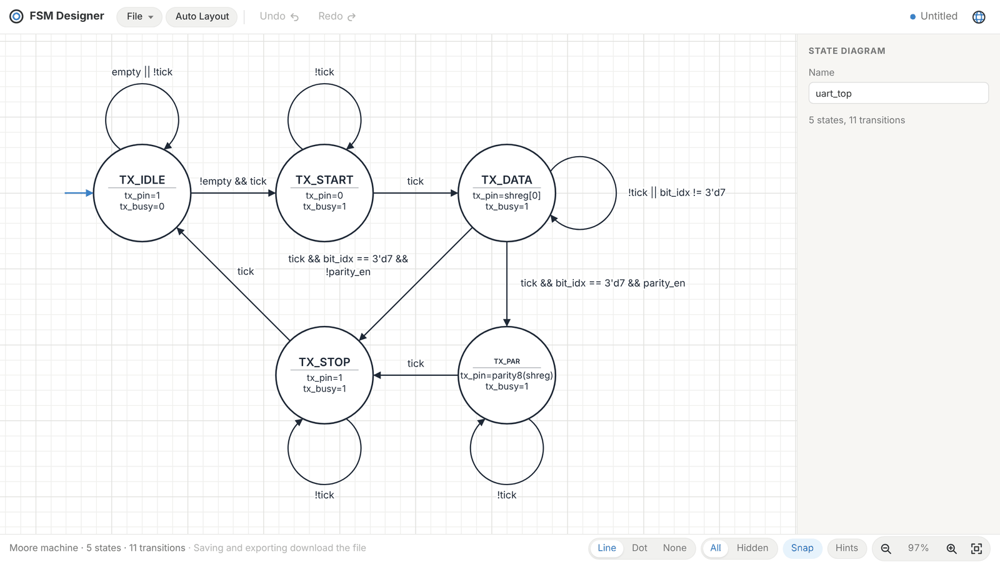
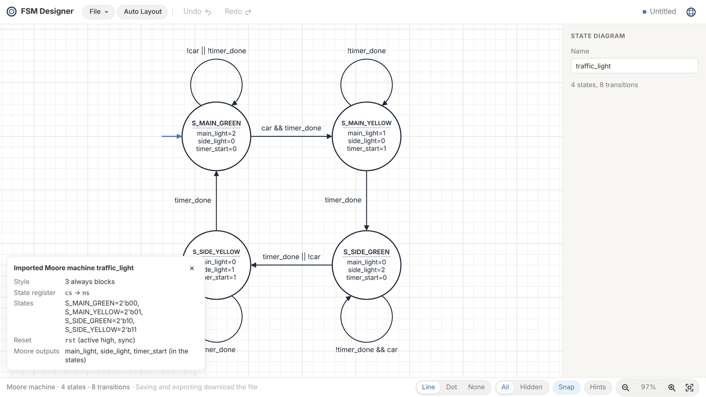

<div align="center">


# FSM Designer

**Clean, readable finite-state-machine diagrams: draw them by hand, generate them from Verilog, or let an AI draw them.**

[](https://github.com/Synerox/fsm-designer/actions/workflows/pages.yml)
[](LICENSE)


[**Try it online**](https://synerox.github.io/fsm-designer/) ·
[Download for Windows](https://github.com/Synerox/fsm-designer/releases/latest) ·
[How auto-layout works](docs/auto-layout.md) ·
[MCP server](apps/mcp-server/README.md) ·
[繁體中文](README.md)



</div>

## Why

Digital-design homework, lab reports and papers keep asking for state diagrams. Drawing them in a general-purpose tool is slow, and every change means re-routing arrows. Generating them with Graphviz-style tools is fast, but the result is usually tangled.

FSM Designer does this one job well:

- Sketch a diagram in seconds. Arrows snap into place and labels sit next to their lines.
- Already have Verilog? Paste it in and get the diagram.
- Press **Auto Layout** and get the layout a person would draw: the main flow reads from the top left, with no crossings and no overly long arrows.
- Export to PNG, SVG, or TikZ code you can drop into a LaTeX document.

## Features

| | |
| --- | --- |
| 🖱️ **Direct editing** | Double-click to add a state, Shift-drag to add a transition, drag a line to bend it. Grid snapping, alignment guides, multi-select, copy/paste and undo/redo. |
| 🔌 **Verilog import** | Analyses Verilog/SystemVerilog (no AI guessing) to find the state register, reset state and every transition's condition, and tells Moore outputs from Mealy outputs. |
| 🧭 **One-click auto-layout** | Tries several layouts and picks the best with a score tuned against real user preferences. |
| 📤 **Export** | PNG, SVG, LaTeX (TikZ `automata`) and `.fsm.json`. Line labels can be shown or hidden, and exports follow the same setting. |
| 🤖 **AI-ready** | A bundled MCP server lets Claude and other agents create, edit, import, lay out and export diagrams. Their files open straight in the desktop app. |
| 🌏 **Three languages** | English, Traditional Chinese and Japanese. |
| 💻 **Web and desktop** | The web version needs no install. The Windows app is a few MB and opens and saves `.fsm.json` files directly. |

## Getting started

### Online

Open **<https://synerox.github.io/fsm-designer/>**. Nothing to install and no sign-in. Your diagram is kept in the browser, and saving or exporting downloads a file.

### Windows desktop app

Download `FSM Designer_x.y.z_x64-setup.exe` from [Releases](https://github.com/Synerox/fsm-designer/releases/latest) and run it. The installed folder holds a single `FSM Designer.exe`; that is expected, since the whole editor is bundled inside and rendered by Windows' built-in WebView2.

### From source

Requires [Node.js](https://nodejs.org/) 22.18 or later (the tests and tools run `.ts` files directly, which Node does without a flag from 22.18) and [pnpm](https://pnpm.io/) 10.

```sh
git clone https://github.com/Synerox/fsm-designer.git
cd fsm-designer
pnpm install
pnpm dev:web      # opens http://localhost:5173
```

## Using the editor

| Action | Result |
| --- | --- |
| Double-click empty space | Add a state |
| Double-click a state | Toggle accepting (double circle) |
| Shift + drag from a state | Add a transition; drag back onto the state for a self loop |
| Shift + drag from empty space onto a state | Add the start arrow |
| Drag a line | Bend or rotate it |
| Type with something selected | Edit its name or condition; `_0` + Space gives ₀, `\alpha` + Space gives α |
| Ctrl + drag | Box select |
| Ctrl + I | Import Verilog |
| F | Fit the diagram to the window |

Press **Hints** in the bottom-right corner for the full list.

## Verilog import

Choose **File ▸ Import Verilog…** (Ctrl + I) and paste or open code that contains a state machine. You get the diagram plus a report of the state encodings, reset and outputs it found.

<div align="center">

</div>

Supported styles include one-, two- and three-block `always` FSMs, `case`/`casez`/`if-else`, states defined with `parameter`/`localparam`/`` `define ``/`typedef enum`, and one-hot encodings. When a file holds several state machines, you choose which one to draw. Details are in [packages/core/src/import/README.md](packages/core/src/import/README.md).

### Moore and Mealy

Each output is classified on import and drawn where it belongs:

- A **Moore output** depends only on the current state and is drawn **inside the state**, e.g. `main_light=2`.
- A **Mealy output** depends on the state and the inputs and is drawn **on the transition**, after the condition, e.g. `coin == 2'b10 / vend=1`.

A diagram with any Mealy output is a Mealy machine; the status bar shows which kind it is.

## Export

Pick a format from the **File** menu:

| Format | Use it for |
| --- | --- |
| **PNG** | Slides, documents, homework |
| **SVG** | Vector graphics that scale cleanly and can be edited in Inkscape or Illustrator |
| **LaTeX (TikZ)** | A TikZ picture that compiles with `pdflatex`, ready for reports and papers |
| **.fsm.json** | The project file; the web app, desktop app and MCP server all share this format |

An excerpt of the LaTeX for a 1011 sequence detector:

```latex
\begin{tikzpicture}[>=Stealth, shorten >=1pt, auto, node distance=2.5cm, semithick, ...]
  \node[state, initial, initial where=left, minimum size=2.20cm] (s0) at (3.00, -4.50) {IDLE};
  \node[state, minimum size=2.20cm] (s1) at (7.50, -7.00) {GOT\_1};
  ...
  \path[->]
    (s0) edge[] (s1)
    (s0) edge[loop, out=120, in=60, looseness=6] (s0)
    ...
  \node[font=\scriptsize\ttfamily, align=center, fill=white, inner sep=1pt] at (5.56, -5.17) {x / z=0};
\end{tikzpicture}
```

## Auto-layout

Auto-layout is a single button with no options. It tries grid, layered, snake and ring layouts and keeps the one with the best score. The score rewards layouts where:

- lines don't cross or pass through states, and labels don't overlap;
- arrows stay short, and the main flow reads rightwards from the reset state in the top left;
- three mutually connected states form an equilateral triangle, and the whole diagram is close to a screen's aspect ratio.

The weights were tuned by repeatedly asking a user to pick between two layouts of the same machine. See [docs/auto-layout.md](docs/auto-layout.md) for the full story.

## Let an AI draw it (MCP server)

`apps/mcp-server` is a [Model Context Protocol](https://modelcontextprotocol.io/) server, so Claude Desktop, Claude Code or any MCP client can draw with the same engine as the editor.

```sh
pnpm install && pnpm -r build
claude mcp add fsm-designer -- node /path/to/fsm-designer/apps/mcp-server/dist/index.js --dir ~/FSMDiagrams
```

Then ask things like:

> Draw a Moore FSM that detects the sequence 1011, with input x and output z, and show me a PNG.
>
> Turn the state machine in `rtl/uart_rx.v` into a diagram and export it as LaTeX.

Claude Desktop setup and the full tool list are in [apps/mcp-server/README.md](apps/mcp-server/README.md) (in Chinese).

## Project layout

A pnpm monorepo:

```
fsm-designer/
├─ packages/core/        shared core: data model, auto-layout, Verilog import, SVG/PNG/LaTeX export
├─ apps/
│  ├─ editor/            the editor (React + Vite), shared by the web and desktop apps
│  ├─ desktop/           Windows desktop shell (Tauri 2)
│  └─ mcp-server/        MCP server for AI agents
├─ tools/layout-taste-test/  builds "pick one of two" pages used to tune the layout score
└─ docs/                 documentation and screenshots
```

## Development

| Command | What it does |
| --- | --- |
| `pnpm dev:web` | Run the editor in the browser (http://localhost:5173) |
| `pnpm dev` | Desktop app in dev mode; needs Rust and the [Tauri prerequisites](https://tauri.app/start/prerequisites/) |
| `pnpm test` | Build and run every test |
| `pnpm -r build` | Build core, the editor and the MCP server |
| `pnpm bundle` | Build the desktop installers (`apps/desktop/src-tauri/target/release/bundle/`) |
| `pnpm taste-test` | Generate a new round of layout comparison pages |

Some Verilog tests simulate the original code with [Icarus Verilog](https://steveicarus.github.io/iverilog/) and compare it with the diagram cycle by cycle; they skip themselves when `iverilog` isn't installed.

GitHub Actions runs every test (with Icarus Verilog installed) on each pull request. Pushing to `main` runs the tests and deploys the web app to GitHub Pages. Pushing a `v*` tag runs the tests, checks that the tag matches the app version, then builds the Windows installers and publishes them on Releases.

## Contributing

Issues and pull requests are welcome!

- **Found a bug or an ugly layout?** [Open an issue](https://github.com/Synerox/fsm-designer/issues), ideally with the `.fsm.json` or the Verilog.
- **Verilog that won't import?** Please include the snippet; it's the most useful input for improving the importer.
- **Before sending a PR**, run `pnpm test` and make sure everything passes.

## Acknowledgements

The editing model is inspired by Evan Wallace's [Finite State Machine Designer](https://madebyevan.com/fsm/).

## License

Released under the [MIT License](LICENSE). Copyright © 2026 Timmy (Synerox)
