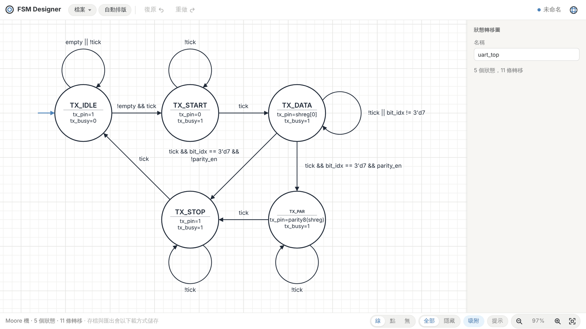
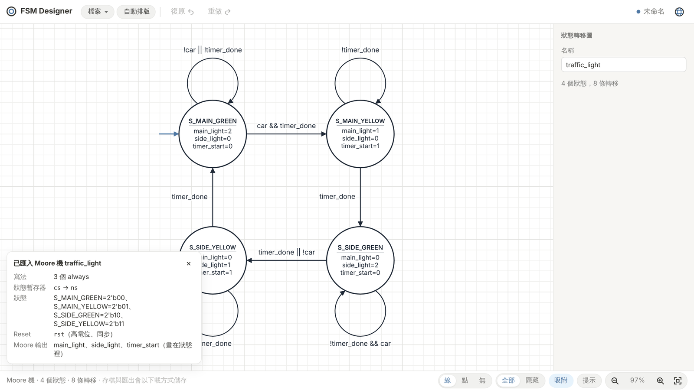

<div align="center">


# FSM Designer

**畫出整齊、好讀的有限狀態機狀態轉移圖：手動畫、從 Verilog 產生，或交給 AI 畫。**

[](https://github.com/Synerox/fsm-designer/actions/workflows/pages.yml)
[](LICENSE)


[**線上試用**](https://synerox.github.io/fsm-designer/) ·
[下載桌面版](https://github.com/Synerox/fsm-designer/releases/latest) ·
[自動排版原理](docs/auto-layout.md) ·
[MCP server](apps/mcp-server/README.md) ·
[English](README.en.md)



</div>

## 為什麼做這個

寫數位電路作業、報告或論文時，常常需要一張狀態轉移圖。用一般繪圖軟體畫很花時間，改一個狀態又要重新拉線；用 Graphviz 之類的工具自動產生，排出來的圖又常常歪七扭八、線條交錯。

FSM Designer 專門做這一件事：

- 用滑鼠幾秒鐘就能畫出一張圖，線會自動貼齊、文字自動排在線旁。
- 已經寫好 Verilog 的話，貼上程式碼就能直接畫出狀態圖。
- 按一下「自動排版」，就會排成人會想畫的樣子：主流程從左上讀起、避免交叉和過長的箭頭。
- 匯出 PNG、SVG，或可以直接放進 LaTeX 文件的 TikZ 程式碼。

## 功能

| | |
| --- | --- |
| 🖱️ **直覺的編輯器** | 雙擊新增狀態、Shift + 拖曳拉出轉移、拖曳線條讓它彎曲。格線吸附、對齊輔助線、多選、複製貼上、復原／重做一應俱全。 |
| 🔌 **從 Verilog 匯入** | 分析 Verilog／SystemVerilog 程式碼（不靠 AI 猜），找出狀態暫存器、reset 狀態、每條轉移的條件，並自動判斷 Moore 或 Mealy 輸出。 |
| 🧭 **一鍵自動排版** | 比較多種排法，用一套依使用者實際偏好調整過的評分挑出最好的一種。 |
| 📤 **多種匯出格式** | PNG、SVG、LaTeX（TikZ `automata`）與 `.fsm.json`。線上的文字可以全部顯示或隱藏，匯出時照同樣的設定。 |
| 🤖 **AI 也能畫** | 內建 MCP server，Claude 等 AI agent 可以建立、修改、匯入、排版並匯出狀態圖，畫好的檔案能直接用桌面版打開繼續改。 |
| 🌏 **三種語言** | 介面支援 English、繁體中文、日本語。 |
| 💻 **網頁版與桌面版** | 網頁版免安裝；Windows 桌面版只有幾 MB，可以直接開啟、儲存 `.fsm.json` 檔。 |

## 快速開始

### 線上版

打開 **<https://synerox.github.io/fsm-designer/>** 就能使用，不需要安裝或登入。圖會自動保存在瀏覽器裡，存檔與匯出會以下載檔案的方式儲存。

### Windows 桌面版

到 [Releases](https://github.com/Synerox/fsm-designer/releases/latest) 下載 `FSM Designer_x.y.z_x64-setup.exe` 並執行。安裝後只會有一個 `FSM Designer.exe`，這是正常的：整個編輯器都包在裡面，畫面用 Windows 內建的 WebView2 顯示。

### 從原始碼執行

需要 [Node.js](https://nodejs.org/) 22 以上與 [pnpm](https://pnpm.io/)。

```sh
git clone https://github.com/Synerox/fsm-designer.git
cd fsm-designer
pnpm install
pnpm dev:web      # 在瀏覽器開啟 http://localhost:5173
```

## 操作方式

| 操作 | 功能 |
| --- | --- |
| 雙擊空白處 | 新增狀態 |
| 雙擊狀態 | 切換接受狀態（雙圈） |
| Shift + 從狀態拖曳 | 新增轉移；拖回自己就是自迴圈 |
| Shift + 從空白處拖曳到狀態 | 新增起始箭頭 |
| 拖曳線條 | 彎曲或旋轉線條 |
| 選取後直接打字 | 編輯名稱或條件；`_0` + 空白鍵變下標 ₀，`\alpha` + 空白鍵變 α |
| Ctrl + 拖曳 | 框選 |
| Ctrl + I | 匯入 Verilog |
| F | 讓整張圖符合視窗 |

完整清單可以按右下角的「提示」查看。

## 從 Verilog 匯入

按「檔案 ▸ 匯入 Verilog…」（Ctrl + I），貼上或開啟含有狀態機的程式碼，就會畫出對應的狀態圖，並列出它找到的狀態編碼、reset 和輸出。

<div align="center">

</div>

支援常見的寫法：一段、兩段、三段式 `always`，`case`／`casez`／`if-else`，`parameter`／`localparam`／`` `define ``／`typedef enum` 定義的狀態，以及 one-hot 編碼。同一個檔案有多個狀態機時可以選擇要畫哪一個。詳細說明見 [packages/core/src/import/README.md](packages/core/src/import/README.md)。

### Moore 與 Mealy

匯入時會自動判斷每個輸出屬於哪一種，並畫在對應的位置：

- **Moore 輸出**只跟目前的狀態有關，畫在**狀態圓圈裡**，例如 `main_light=2`。
- **Mealy 輸出**同時跟狀態和輸入有關，畫在**轉移線上**，寫在條件後面，例如 `coin == 2'b10 / vend=1`。

一張圖只要有任何 Mealy 輸出，就會標成 Mealy 機，左下角的狀態列會顯示是哪一種。

## 匯出

在「檔案」選單選擇格式：

| 格式 | 用途 |
| --- | --- |
| **PNG** | 貼進簡報、文件或作業 |
| **SVG** | 向量圖，放大不失真，可以再用 Inkscape／Illustrator 修改 |
| **LaTeX (TikZ)** | 產生可用 `pdflatex` 編譯的 TikZ 圖，可以直接放進報告或論文；標籤含中日韓文字時改用 `xelatex` 或 `lualatex`（檔頭會載入 `ctex`）；字型缺的字會印成空白，`ctex` 在 Linux 與 Overleaf 的預設字型 Fandol 沒有韓文、也缺部分繁體字（如「綠」「黃」），這時取消檔頭 `\setCJKmainfont{Noto Serif CJK TC}` 那一行的註解，或換成你有的 CJK 字型 |
| **.fsm.json** | 專案檔，桌面版、網頁版與 MCP server 都讀寫同一種格式 |

以 1011 序列偵測器為例，匯出的 LaTeX 節錄如下：

```latex
\begin{tikzpicture}[>=Stealth, shorten >=1pt, auto, node distance=2.5cm, semithick, ...]
  \node[state, initial, initial where=left, minimum size=2.20cm] (s0) at (3.00, -4.50) {IDLE};
  \node[state, minimum size=2.20cm] (s1) at (7.50, -7.00) {GOT\_1};
  ...
  \path[->]
    (s0) edge[] (s1)
    (s0) edge[loop, out=120, in=60, looseness=6] (s0)
    ...
  \node[font=\scriptsize\ttfamily, align=center, fill=white, inner sep=1pt] at (5.56, -5.17) {x / z=0};
\end{tikzpicture}
```

## 自動排版

自動排版只有一個按鈕，沒有任何選項。它會同時嘗試方格、分層流程、蛇形與環形等排法，用同一套分數挑最好的一種。分數考慮的事情包括：

- 線條不交叉、不穿過其他狀態，文字不互相重疊；
- 避免太長的箭頭，主流程從左上角的 reset 狀態開始往右讀；
- 互相連接的三個狀態排成正三角形，整張圖接近螢幕的長寬比。

各項分數的權重，是讓使用者在「同一張圖的兩種排法」之間反覆挑選後調整出來的。完整說明見 [docs/auto-layout.md](docs/auto-layout.md)。

## 讓 AI 幫你畫（MCP server）

`apps/mcp-server` 是一個 [Model Context Protocol](https://modelcontextprotocol.io/) server，讓 Claude Desktop、Claude Code 或任何 MCP client 使用和編輯器相同的引擎畫圖。

```sh
pnpm install && pnpm -r build
claude mcp add fsm-designer -- node /path/to/fsm-designer/apps/mcp-server/dist/index.js --dir ~/FSMDiagrams
```

接著就可以說：

> 畫一個偵測序列 1011 的 Moore FSM，輸入 x、輸出 z，匯出 PNG 給我看。
>
> 把 `rtl/uart_rx.v` 裡的狀態機畫成狀態圖，匯出 LaTeX。

Claude Desktop 的設定方式與所有工具的說明見 [apps/mcp-server/README.md](apps/mcp-server/README.md)。

## 專案結構

這是一個 pnpm monorepo：

```
fsm-designer/
├─ packages/core/        共用核心：資料模型、自動排版、Verilog 匯入、SVG／PNG／LaTeX 匯出
├─ apps/
│  ├─ editor/            編輯器（React + Vite），網頁版與桌面版共用
│  ├─ desktop/           Windows 桌面版外殼（Tauri 2）
│  └─ mcp-server/        給 AI agent 用的 MCP server
├─ tools/layout-taste-test/  產生「兩種排法選一個」的比較頁，用來調整排版分數
└─ docs/                 說明文件與截圖
```

## 開發

| 指令 | 說明 |
| --- | --- |
| `pnpm dev:web` | 在瀏覽器執行編輯器（http://localhost:5173） |
| `pnpm dev` | 桌面版開發模式，需要 Rust 與 [Tauri 的系統需求](https://tauri.app/start/prerequisites/) |
| `pnpm test` | 建置並執行所有測試 |
| `pnpm -r build` | 建置 core、編輯器與 MCP server |
| `pnpm bundle` | 產生桌面版安裝檔（`apps/desktop/src-tauri/target/release/bundle/`） |
| `pnpm taste-test` | 產生新一輪的排版比較頁 |

部分 Verilog 測試會用 [Icarus Verilog](https://steveicarus.github.io/iverilog/) 逐拍比對狀態圖與原始程式碼，沒有安裝 `iverilog` 時會自動略過。

推送到 `main` 時，GitHub Actions 會執行測試並把網頁版部署到 GitHub Pages；推送 `v*` 標籤時會建置 Windows 安裝檔並發布到 Releases。

## 參與貢獻

歡迎回報問題或送 Pull Request！

- **發現 bug 或排版不好看的圖**：請[開一個 issue](https://github.com/Synerox/fsm-designer/issues)，最好附上 `.fsm.json` 或 Verilog 程式碼。
- **有 Verilog 匯入不了**：請附上程式碼片段，這是改進匯入器最有用的資料。
- **送 PR 前**：請先執行 `pnpm test`，確定所有測試都通過。

## 致謝

編輯器的操作方式參考了 Evan Wallace 的 [Finite State Machine Designer](https://madebyevan.com/fsm/)。

## 授權

以 [MIT License](LICENSE) 釋出。Copyright © 2026 Timmy (Synerox)
